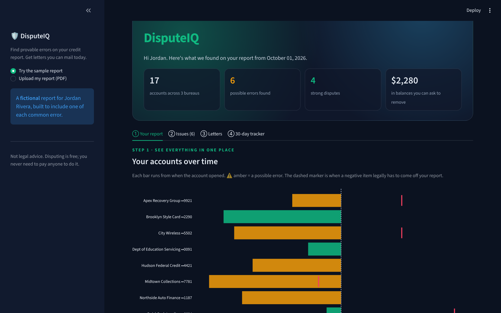
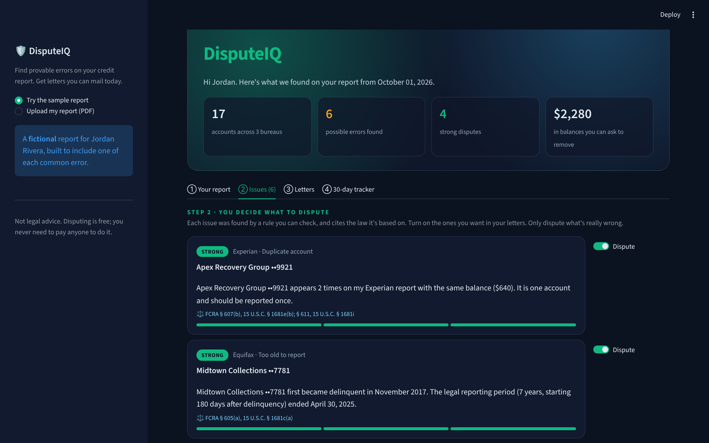
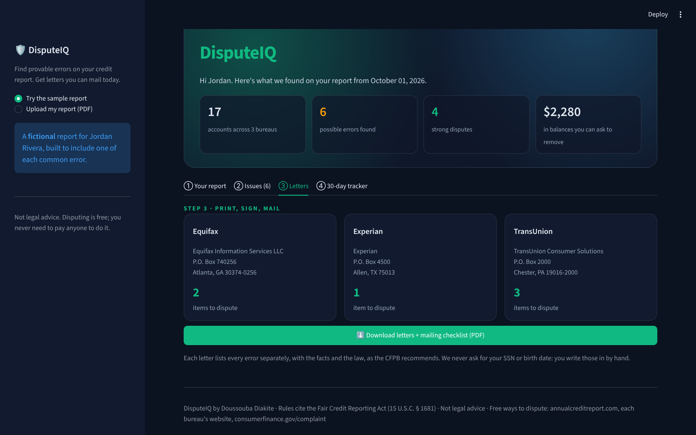

# DisputeIQ 🛡️

**Find provable errors on your credit report and get mail-ready dispute letters, with the law cited for every item.**

One in five people has an error on at least one of their credit reports, and fixing it is free. But the process is confusing, so people either give up or pay "credit repair" companies for something they can do themselves. DisputeIQ walks you through it in four steps.



| Issues, each with the law behind it | Letters ready to mail |
| --- | --- |
|  |  |

## How it works

```
 PDF report ──► Claude extracts accounts ──► Python rules flag errors ──► You approve ──► Letters + 30-day tracker
              (tool use, structured JSON)    (deterministic, cited,       (human in        (ReportLab PDF,
                                              tested)                      the loop)         FCRA § 611 clock)
```

1. **Extract.** Claude reads the messy report text and calls a `record_accounts` tool, returning every account as structured data. That's all the AI does. It never decides what to dispute.
2. **Flag.** A plain-Python rules engine checks for errors you can prove:

   | Rule | What it catches | Law |
   | --- | --- | --- |
   | Duplicate account | The same account listed twice on one report | FCRA § 607(b), § 611 |
   | Too old to report | Negative items past 7 years (+180 days); bankruptcies past 10 | FCRA § 605(a), (c) |
   | Balance / status mismatch | The same account reported differently by different bureaus | FCRA § 607(b), § 611 |
   | Paid but shows a balance | "Paid, closed" accounts still showing money owed | FCRA § 607(b), § 611 |
   | Same debt counted twice | A debt sold to a collector that the original creditor still reports as owed | FCRA § 607(b), § 611 |
   | Not my account | Accounts the user marks as never opened | FCRA § 611, § 605B |

3. **Approve.** The user turns each issue on or off. Nothing is disputed automatically. The bureaus can disregard disputes that look frivolous, and a person should stand behind every claim.
4. **Mail and track.** One letter per bureau, following the [CFPB's guidance](https://files.consumerfinance.gov/f/documents/cfpb_your-money-your-goals_dispute-credit-report_handout_2018-11.pdf): each error described separately, with the facts, the request, and the legal basis. A checklist covers certified mail, and the tracker counts down the 30 days the bureau has to respond (FCRA § 611(a)(1)), including the 15-day extension rule.

## Privacy by design
- The app **never asks for a Social Security number or date of birth.** The letter has blank lines to fill in by hand.
- Reports are processed in memory and never saved.
- Only the last 4 digits of account numbers are kept.
- `.gitignore` blocks every PDF except the fictional sample, so a real report can't be committed by accident.

## Try it without a real report
`samples/sample_report.pdf` is a **fictional** tri-bureau report (made by `scripts/make_sample.py`) with one of each error planted in it. The sample runs without an API key.

## Run it
```bash
pip install -r requirements.txt
streamlit run app.py
pytest                                   # 22 tests: every rule, the tracker, and the sample end to end
```
To read real reports, add an Anthropic API key in `.streamlit/secrets.toml` (see the `.example` file) or paste it in the sidebar.

## Project structure
```
app.py                 Streamlit interface: report timeline, bureau comparison, issues, letters, tracker
disputeiq/
  extract.py           PDF text (PyMuPDF) -> accounts, via Claude tool use or the sample parser
  rules.py             the rules engine, every rule cited
  letters.py           mail-ready letters (ReportLab) with verified bureau addresses
  tracker.py           FCRA § 611 deadline logic
  models.py            Account, Report, Flag
scripts/make_sample.py builds the fictional sample report
tests/                 pytest suite
```

## Background
This started as a Google Colab prototype where I first wired up Claude tool calling to a Python duplicate checker. DisputeIQ grows that loop into a full product: extraction, a tested rules engine, letters, and tracking.

*Not legal advice. Disputing is always free: [annualcreditreport.com](https://www.annualcreditreport.com), each bureau's website, or a complaint at [consumerfinance.gov](https://www.consumerfinance.gov/complaint/).*

Built by **Doussouba Diakite** · Computer Engineering Technology, CUNY City Tech · [LinkedIn](https://www.linkedin.com/in/doussouba-diakite-a11087324) · [Pathways](https://github.com/doussouba-diakite/Pathways-App)
